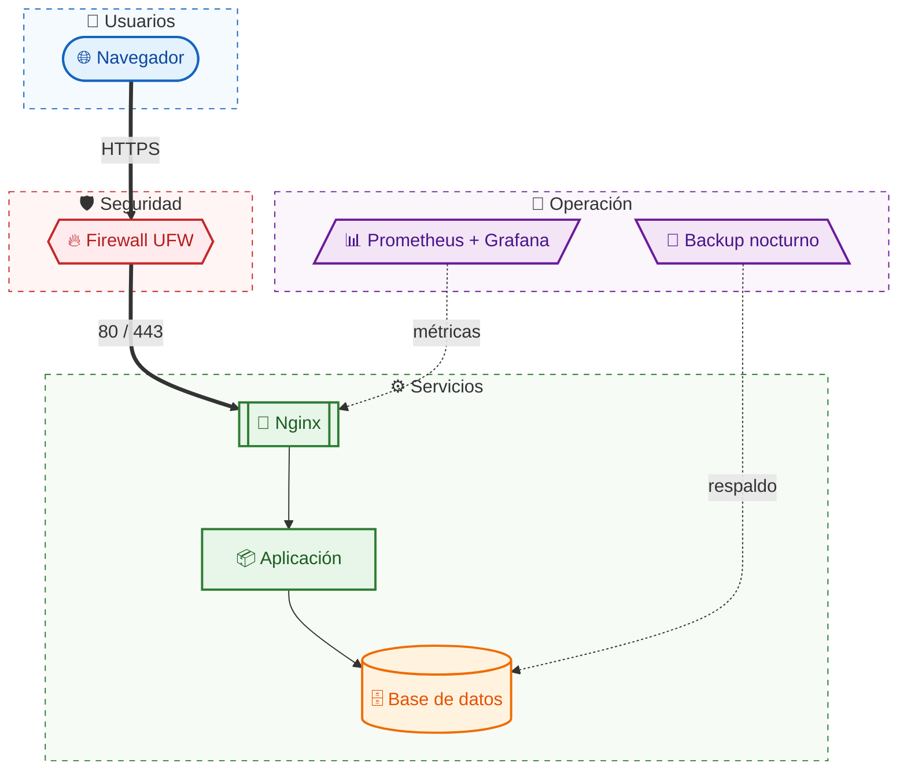

# Arquitectura por capas

## Leyenda

| Forma | Significado |
|-------|-------------|
| Óvalo | Cliente o usuario |
| Hexágono | Seguridad (firewall) |
| Rectángulo con barras | Servicio expuesto (Nginx) |
| Cilindro | Almacenamiento de datos |
| Paralelogramo | Operación y mantenimiento |
| Flecha gruesa | Tráfico de usuarios |
| Flecha punteada | Métricas y respaldos |
